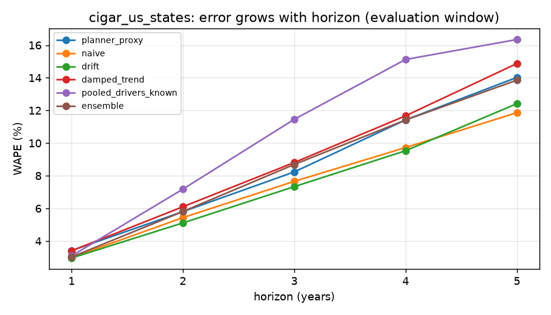
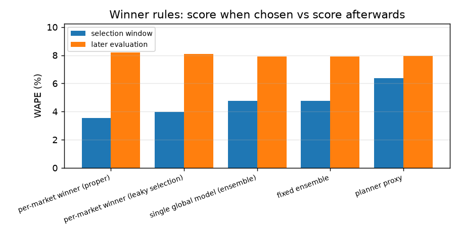
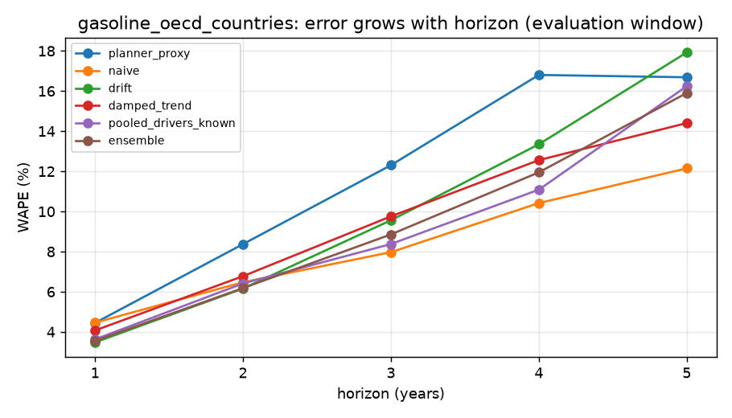
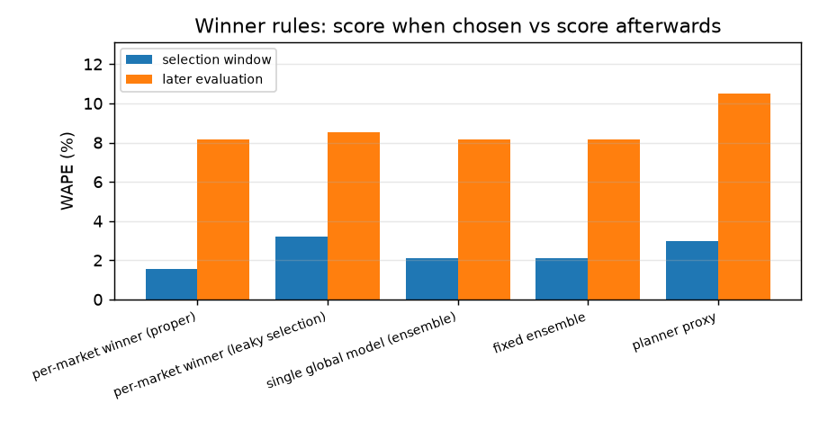

# Results

Generated by `python scripts/run_review.py`. All numbers are reproducible from the committed data with the pinned requirements.

## cigar_us_states

46 markets, 1963-1992; rolling origins 1972-1991, horizons 1-5 years. Decision date for winner rules: **1981** (only errors whose target year is <= 1981 may be used to choose; evaluation uses forecasts issued from 1981 onward).

### 1. Winner rules

| rule | selection_wape | evaluation_wape | evaluation_bias | optimism | excess_optimism_vs_fixed_ensemble |
|---|---|---|---|---|---|
| per-market winner (proper) | 0.036 | 0.082 | 0.074 | 0.046 | 0.015 |
| per-market winner (leaky selection) | 0.040 | 0.081 | 0.074 | 0.041 | 0.010 |
| single global model (ensemble) | 0.048 | 0.079 | 0.071 | 0.031 | 0.000 |
| fixed ensemble | 0.048 | 0.079 | 0.071 | 0.031 | 0.000 |
| planner proxy | 0.064 | 0.079 | 0.027 | 0.016 | -0.016 |

- Per-market winners chosen: naive (16), ensemble (13), damped_trend (6), pooled_gbm (5), drift (4), pooled_drivers_known (2).
- The proper winner equals the ex-post best model in 2.2% of markets.
- Leaky selection changes the chosen model in 32.6% of markets.

### 2. Forecast Value Added vs planner proxy (evaluation window)

FVA = planner WAPE minus model WAPE, in percentage points; 90% interval from resampling markets.

| model | wape | fva_pts | fva_ci_low | fva_ci_high | share_markets_better | bias |
|---|---|---|---|---|---|---|
| drift | 0.069 | 1.024 | 0.365 | 1.851 | 0.739 | 0.050 |
| naive | 0.070 | 0.929 | -0.090 | 2.032 | 0.652 | 0.060 |
| pooled_drivers_forecast | 0.076 | 0.335 | -0.661 | 1.508 | 0.696 | 0.053 |
| ensemble | 0.079 | 0.033 | -0.809 | 1.083 | 0.652 | 0.071 |
| winner_rule | 0.082 | -0.255 | -1.192 | 0.826 | 0.522 | 0.074 |
| damped_trend | 0.083 | -0.351 | -1.243 | 0.663 | 0.522 | 0.072 |
| pooled_drivers_known | 0.098 | -1.873 | -2.970 | -0.627 | 0.435 | 0.092 |
| pooled_gbm | 0.112 | -3.221 | -4.504 | -1.808 | 0.304 | 0.103 |

### 3. WAPE by horizon (evaluation window)

| horizon | planner_proxy | naive | drift | damped_trend | pooled_drivers_known | pooled_drivers_forecast | pooled_gbm | ensemble |
|---|---|---|---|---|---|---|---|---|
| 1 | 0.034 | 0.030 | 0.030 | 0.034 | 0.031 | 0.029 | 0.032 | 0.030 |
| 2 | 0.058 | 0.054 | 0.051 | 0.061 | 0.072 | 0.052 | 0.070 | 0.058 |
| 3 | 0.082 | 0.077 | 0.073 | 0.088 | 0.115 | 0.083 | 0.121 | 0.087 |
| 4 | 0.114 | 0.097 | 0.095 | 0.117 | 0.151 | 0.115 | 0.180 | 0.114 |
| 5 | 0.140 | 0.119 | 0.124 | 0.149 | 0.163 | 0.134 | 0.211 | 0.139 |

### 4. Long-horizon evidence for `drift` vs planner proxy

| horizon | origins | non_overlapping_windows | fva_pts | ci_low | ci_high |
|---|---|---|---|---|---|
| 1 | 11 | 11 | 0.456 | 0.215 | 0.746 |
| 2 | 10 | 5 | 0.690 | 0.155 | 1.351 |
| 3 | 9 | 3 | 0.902 | 0.264 | 1.671 |
| 4 | 8 | 2 | 1.887 | 0.689 | 3.230 |
| 5 | 7 | 2 | 1.610 | 0.078 | 3.245 |

### 5. External drivers: known vs forecast vs oracle (WAPE by horizon)

| horizon | drift | pooled_drivers_known | pooled_drivers_forecast | pooled_drivers_oracle |
|---|---|---|---|---|
| 1 | 0.030 | 0.031 | 0.029 | 0.024 |
| 2 | 0.051 | 0.072 | 0.052 | 0.042 |
| 3 | 0.073 | 0.115 | 0.083 | 0.075 |
| 4 | 0.095 | 0.151 | 0.115 | 0.112 |
| 5 | 0.124 | 0.163 | 0.134 | 0.129 |

`pooled_drivers_oracle` uses realised future drivers (look-ahead). The gap between it and `pooled_drivers_forecast` is the part of a driver's apparent value that is not available at forecast time.

## gasoline_oecd_countries

18 markets, 1960-1978; rolling origins 1966-1977, horizons 1-5 years. Decision date for winner rules: **1971** (only errors whose target year is <= 1971 may be used to choose; evaluation uses forecasts issued from 1971 onward).

### 1. Winner rules

| rule | selection_wape | evaluation_wape | evaluation_bias | optimism | excess_optimism_vs_fixed_ensemble |
|---|---|---|---|---|---|
| per-market winner (proper) | 0.015 | 0.082 | 0.051 | 0.066 | 0.006 |
| per-market winner (leaky selection) | 0.032 | 0.085 | 0.055 | 0.053 | -0.007 |
| single global model (ensemble) | 0.021 | 0.081 | 0.055 | 0.060 | 0.000 |
| fixed ensemble | 0.021 | 0.081 | 0.055 | 0.060 | 0.000 |
| planner proxy | 0.030 | 0.105 | 0.036 | 0.075 | 0.015 |

- Per-market winners chosen: drift (5), damped_trend (5), pooled_gbm (3), ensemble (2), pooled_drivers_known (2), naive (1).
- The proper winner equals the ex-post best model in 5.6% of markets.
- Leaky selection changes the chosen model in 61.1% of markets.

### 2. Forecast Value Added vs planner proxy (evaluation window)

FVA = planner WAPE minus model WAPE, in percentage points; 90% interval from resampling markets.

| model | wape | fva_pts | fva_ci_low | fva_ci_high | share_markets_better | bias |
|---|---|---|---|---|---|---|
| naive | 0.076 | 2.919 | 0.813 | 5.412 | 0.611 | -0.068 |
| pooled_drivers_forecast | 0.079 | 2.577 | 1.411 | 3.953 | 0.833 | 0.049 |
| pooled_drivers_known | 0.080 | 2.464 | 1.408 | 3.741 | 0.944 | 0.046 |
| ensemble | 0.081 | 2.345 | 1.226 | 3.548 | 0.778 | 0.055 |
| winner_rule | 0.082 | 2.319 | 1.182 | 3.515 | 0.778 | 0.051 |
| pooled_gbm | 0.085 | 2.028 | 1.051 | 3.138 | 0.889 | 0.058 |
| damped_trend | 0.085 | 1.968 | 0.735 | 3.264 | 0.722 | 0.054 |
| drift | 0.087 | 1.752 | 0.627 | 2.837 | 0.722 | 0.066 |

### 3. WAPE by horizon (evaluation window)

| horizon | planner_proxy | naive | drift | damped_trend | pooled_drivers_known | pooled_drivers_forecast | pooled_gbm | ensemble |
|---|---|---|---|---|---|---|---|---|
| 1 | 0.044 | 0.045 | 0.035 | 0.041 | 0.036 | 0.036 | 0.039 | 0.036 |
| 2 | 0.084 | 0.065 | 0.062 | 0.068 | 0.064 | 0.065 | 0.057 | 0.062 |
| 3 | 0.123 | 0.080 | 0.096 | 0.098 | 0.084 | 0.084 | 0.090 | 0.089 |
| 4 | 0.168 | 0.104 | 0.133 | 0.126 | 0.111 | 0.112 | 0.117 | 0.119 |
| 5 | 0.167 | 0.121 | 0.179 | 0.144 | 0.162 | 0.151 | 0.186 | 0.159 |

### 4. Long-horizon evidence for `naive` vs planner proxy

| horizon | origins | non_overlapping_windows | fva_pts | ci_low | ci_high |
|---|---|---|---|---|---|
| 1 | 7 | 7 | -0.011 | -0.610 | 0.643 |
| 2 | 6 | 3 | 1.897 | 0.261 | 3.596 |
| 3 | 5 | 2 | 4.335 | 1.800 | 7.353 |
| 4 | 4 | 1 | 6.386 | 2.837 | 10.833 |
| 5 | 3 | 1 | 4.540 | 0.010 | 10.192 |

### 5. External drivers: known vs forecast vs oracle (WAPE by horizon)

| horizon | drift | pooled_drivers_known | pooled_drivers_forecast | pooled_drivers_oracle |
|---|---|---|---|---|
| 1 | 0.035 | 0.036 | 0.036 | 0.034 |
| 2 | 0.062 | 0.064 | 0.065 | 0.051 |
| 3 | 0.096 | 0.084 | 0.084 | 0.051 |
| 4 | 0.133 | 0.111 | 0.112 | 0.068 |
| 5 | 0.179 | 0.162 | 0.151 | 0.099 |

`pooled_drivers_oracle` uses realised future drivers (look-ahead). The gap between it and `pooled_drivers_forecast` is the part of a driver's apparent value that is not available at forecast time.

